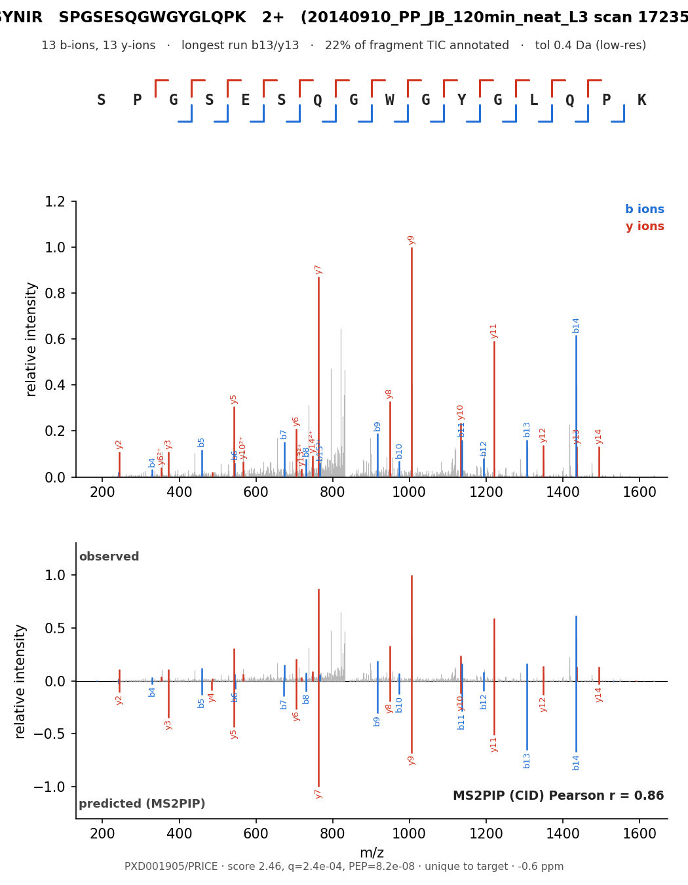

# psm-analysis

Annotate peptide–spectrum matches (PSMs) and mirror them against MS2PIP predictions, for
manual PSM verification. Each figure has three panels: a b/y **fragment-coverage map**, the
**annotated observed** MS2, and an **observed-vs-MS2PIP mirror**. Optional rubric **grade
badge** (excellent / good / caution / low-information). Import package: `psmplot`.




## Install

Python ≥ 3.8 with **numpy, matplotlib, pyteomics, ms2pip** (ms2pip does the fragment-intensity
prediction). No install needed — the scripts add the repo to `sys.path`; `pip install -e .`
also provides a `plot-psm` command.

## Generate a figure

**Input:** peptide sequence, charge, a spectrum file (**MGF / mzML / PROXI-JSON**), scan number.

```bash
python scripts/plot_psm.py \
    --peptide LMDLSHTNSVAELQETPGK --charge 3 \
    --spectrum run.mgf --scan 30662 --out fig.png     # optional: --minimal  --badge
```

**Output:** `fig.png` (+ `fig.pdf`) and a QC line (b/y counts, coverage, precursor ppm, MS2PIP
r, grade). Batch from a TSV (columns `peptide charge scan spectra_path [dataset] [run] [target]`):

```bash
python scripts/render_table.py --table psms.tsv --outdir out
```

## PSM source pipeline

PSMs identified with **MS-GF+**, rescored with **MS²Rescore v2 / Percolator**; high-confidence
= **q < 0.01 AND PEP < 0.1**. Modifications: fixed Carbamidomethyl-C, variable Oxidation-M
(inferred from the precursor mass), TMT-6plex where applicable; MS2PIP model chosen per
acquisition (HCD2019 / CID / TMT / Immuno-HCD).

## Portability

| general — any peptide + spectrum | project-specific (this study) |
|---|---|
| `psmplot/` package (`plot`, `annotate`, `prediction`, `grade`, `theme`, `spectra`), `scripts/plot_psm.py`, `scripts/render_table.py` | `psmplot/datasets.py` (dataset → MS2PIP-model map), `scripts/render_flagships.py`, `render_macrophage_flagships.py`, `make_grades_*.py` (hard-code this paper's tables and file paths) |

Restyle everything from `psmplot/theme.py` (one `Theme` dataclass — palette, size, fonts, badge colors).
